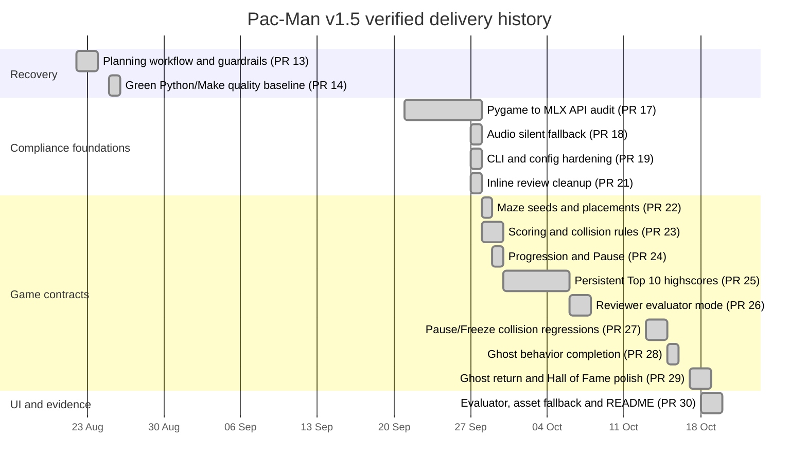

# Retrospective timeline

Snapshot: 2026-10-19.

This Gantt is reconstructed from real PR creation and merge dates. It is a
retrospective record, not a claim that these dates were estimated in advance.

## Remaining sequence (dates intentionally TBD)

1. Confirm team organization and complete the remaining #11 evidence.
2. Manually smoke complete gameplay and persisted highscores in both packages.
3. Publish the verified build free and unlisted/private on Itch.io.
4. Download from Itch.io and repeat the package smoke.
5. Record the URL and final published artifact hashes.
6. Run the final requirement-to-evidence audit and close epic #1.

The #12 implementation branch has already generated Windows and Linux packages
from a clean clone in 26 s and 30 s, verified their contents and started both
outside the checkout with normal dummy audio and forced audio failure. These
facts move into the historical Gantt only after their PR is merged.

Calendar dates for manual review and publication are deliberately omitted until
the team has real availability and an Itch.io project. This avoids converting
guesses into project evidence.
